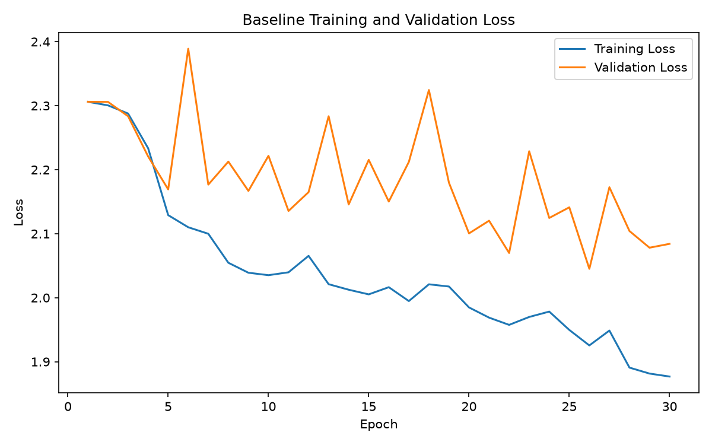
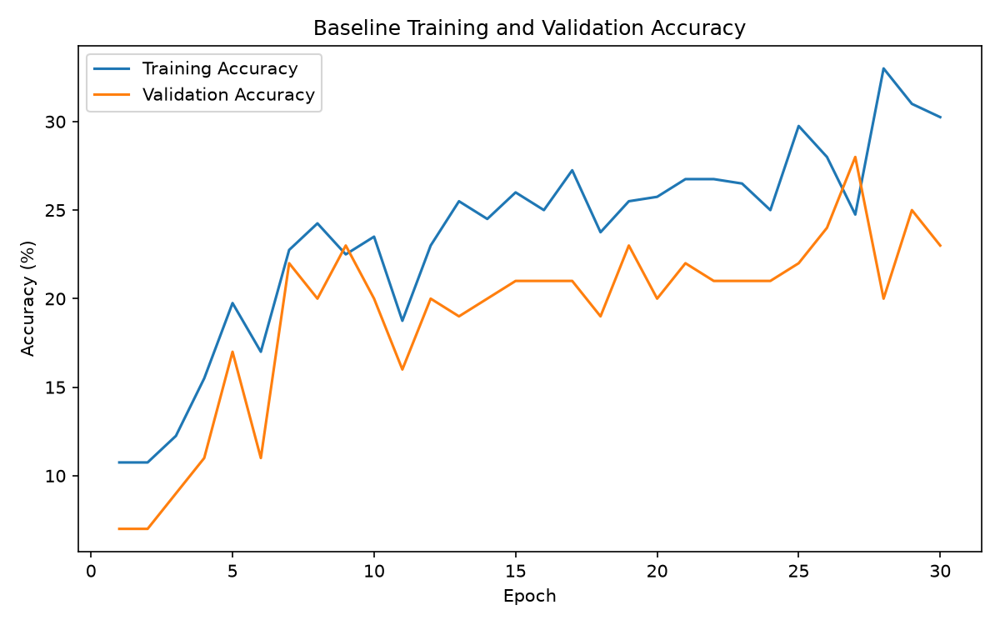
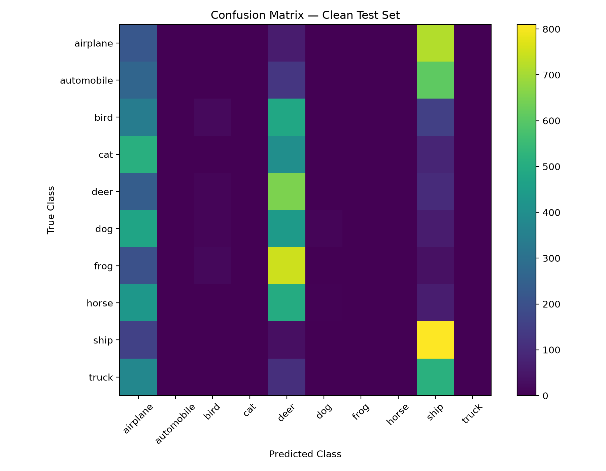
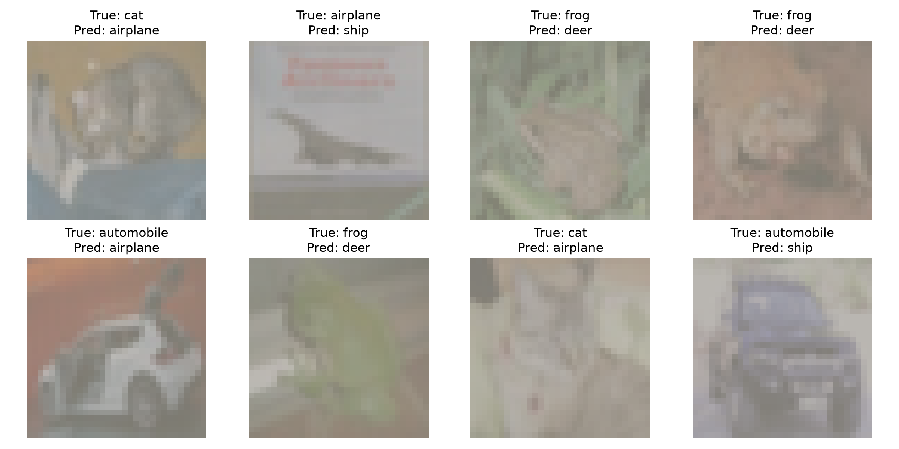

# Deep Learning for Perception — Robust CIFAR-10 Classification

A deep learning project focused on **robust image classification under limited training data and distribution shifts** using PyTorch and CIFAR-10.

The project investigates how data augmentation, regularization, Inception-style architecture, and test-time augmentation affect CNN performance when only **400 training images** are available.

---

## Project Overview

This project was developed for **Deep Learning for Perception — Assignment #2**.

### Main Objectives

- Build a CNN with an **Inception-style module**
- Train using only **400 CIFAR-10 training images**
- Evaluate performance on clean and shifted test distributions
- Investigate data augmentation and regularization
- Perform a multi-configuration ablation study
- Evaluate class-wise performance and misclassified examples
- Explore Test-Time Augmentation (TTA)
- Report results across multiple random seeds

---

## Dataset

The project uses **CIFAR-10** through `torchvision`.

| Dataset | Images |
|---|---:|
| Original training set | 50,000 |
| `train_small` | 500 |
| Training split | 400 |
| Validation split | 100 |
| Clean test set | 10,000 |
| Shifted test set | 10,000 |

The 500-image subset contains **50 images per class**, followed by a fixed 400/100 train-validation split.

The clean test set was kept separate from training and validation.

---

## Model Architecture

The CNN uses an **Inception-style module** containing parallel branches with:

- `1×1` convolutions
- `3×3` convolutions
- `5×5` convolutions
- Pooling followed by `1×1` projection

The architecture also uses:

- ReLU activation
- Max pooling
- Batch Normalization
- Global Average Pooling
- Dropout
- Fully connected classification layer

### Trainable Parameters

The model contains approximately **68K trainable parameters**, remaining well below the assignment limit of 1 million parameters.

---

## Experimental Setup

### Baseline

The baseline model was trained using:

- 400 training images
- No data augmentation
- Adam optimizer
- Learning rate: `0.001`
- Weight decay: `0.0001`
- 30 epochs
- Fixed random seed

### Data Augmentation

The augmentation experiments included:

- Random horizontal flipping
- Random rotation up to ±25°
- Brightness variation
- Contrast variation
- Random Erasing
- Mixup

Augmentation was applied **on-the-fly during training**.

### Regularization

The experiments also investigated:

- Dropout
- Weight decay
- Batch Normalization
- Learning-rate scheduling
- Early stopping
- Label smoothing

---

## Distribution Shift

The shifted test set applies controlled transformations including:

- Rotation up to ±25°
- Brightness changes
- Contrast changes
- Approximately 25% rectangular occlusion

A fixed seed was used to make the shifted evaluation reproducible.

The shifted evaluation was designed to measure the model's robustness to changes in image appearance and partial occlusion.

---

# Results

## Baseline Performance

The baseline model achieved:

| Evaluation Set | Accuracy |
|---|---:|
| Clean Test | **27.23%** |
| Shifted Test | **10.28%** |

The large performance drop demonstrates that the model was highly sensitive to distribution shifts when trained without augmentation.

### Baseline Learning Curves





---

## Ablation Study

Seven configurations were evaluated using **three random seeds**.

Results are reported as **mean ± standard deviation**.

| Configuration | Validation | Clean Test | Shifted Test |
|---|---:|---:|---:|
| No Augmentation | 25.33 ± 2.52 | 27.07 ± 0.21 | 14.20 ± 3.48 |
| Geometric Only | 20.67 ± 2.31 | 13.18 ± 0.69 | 24.02 ± 0.48 |
| Photometric Only | 22.33 ± 0.58 | 15.75 ± 1.42 | 24.50 ± 1.99 |
| Geometric + Photometric | 23.00 ± 3.46 | 15.88 ± 1.05 | 23.54 ± 2.30 |
| + Random Erasing | 21.33 ± 1.53 | 14.57 ± 1.21 | 24.16 ± 0.88 |
| Mixup + Label Smoothing | 21.67 ± 2.49 | 17.73 ± 1.19 | 19.55 ± 2.09 |
| **Final Model** | **23.33 ± 2.05** | **16.24 ± 2.17** | **28.11 ± 2.38** |

### Key Result

The **Final Model achieved the highest shifted-test accuracy**:

**28.11 ± 2.38%**

This indicates improved robustness to the specified distribution shifts compared with the other evaluated configurations.

---

## Class-wise Evaluation

The final analysis model showed highly uneven class performance:

| Class | Accuracy |
|---|---:|
| Airplane | 21.90% |
| Automobile | 0.00% |
| Bird | 2.20% |
| Cat | 0.00% |
| Deer | 65.00% |
| Dog | 1.20% |
| Frog | 0.00% |
| Horse | 0.00% |
| Ship | 81.00% |
| Truck | 0.00% |

These results highlight the difficulty of learning reliable class boundaries from only 400 training images.

---

## Confusion Matrix



---

## Misclassified Examples

Eight misclassified test examples were visualized to analyze model failure cases.



---

## Test-Time Augmentation

Horizontal-flip Test-Time Augmentation was evaluated by averaging predictions from:

1. The original image
2. A horizontally flipped image

Results:

| Evaluation Set | TTA Accuracy |
|---|---:|
| Clean Test | **17.12%** |
| Shifted Test | **27.57%** |

TTA provided a small improvement for the clean-test evaluation of the final analysis model, while shifted-test performance remained slightly below the overall three-seed final-model result.

---

## Notebook

The complete implementation, experiments, training procedures, evaluation, and results are available in the executed Jupyter Notebook.

📓 **[View the Complete Notebook](DLP.ipynb)**

---

## Key Findings

1. Training with only 400 images creates a strong overfitting/generalization challenge.
2. The baseline model performed substantially worse on shifted images.
3. Data augmentation significantly improved robustness to distribution shifts.
4. Different augmentation strategies produced different robustness levels.
5. The final configuration achieved the strongest shifted-test result in the three-seed ablation study.
6. Class-wise results show severe imbalance in learned performance despite equal class representation in the selected training subset.
7. Test-Time Augmentation provided limited additional improvement.

---

## Reproducibility

Experiments use fixed random seeds for reproducibility.

Three seeds were used for the main ablation study:

```text
42
123
456
